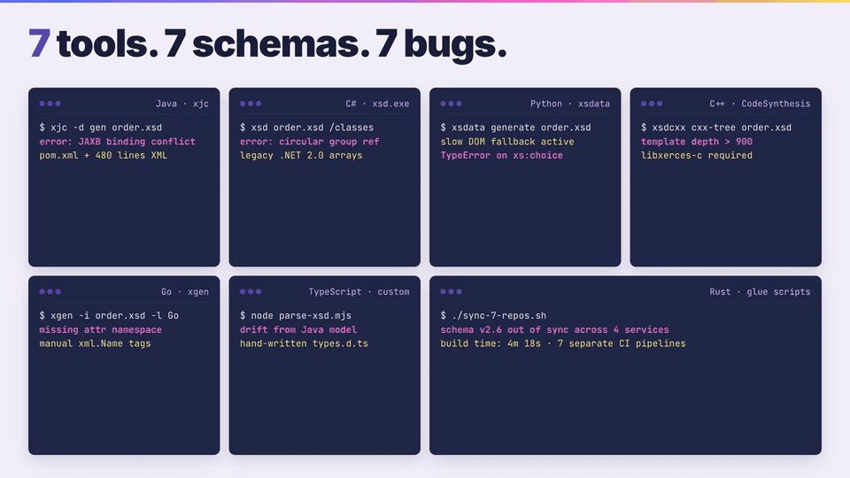

<h1 align="center">
  
</h1>

<p align="center">
  <strong>XSD-to-Code Compiler &amp; Streaming XML Runtime</strong><br>
  <em>Python • Rust • C++20 • Java 22+ • TypeScript • Go • C# 12 • WebAssembly</em><br>
  <strong><a href="https://polyxml.github.io/PolyXML/playground/">Try the Browser Playground (WASM) →</a></strong>
</p>

<p align="center">
  <a href="https://github.com/polyxml/PolyXML/actions"></a>
  <a href="https://polyxml.github.io/PolyXML/"></a>
  <a href="https://github.com/polyxml/polyxml-w3c-tests"></a>
  <a href="https://github.com/polyxml/PolyXML/blob/main/crates/polyxml-python/pyproject.toml"></a>
  <a href="https://github.com/astral-sh/ruff"></a>
  <a href="https://opensource.org/licenses/MIT"></a>
</p>

<p align="center">
  <a href="https://crates.io/crates/polyxml"></a>
  <a href="https://crates.io/crates/polyxml-cli"></a>
  <a href="https://pypi.org/project/polyxml/"></a>
  <a href="https://www.npmjs.com/package/@polyxml/node"></a>
  <a href="https://central.sonatype.com/artifact/io.github.polyxml/polyxml"></a>
  <a href="https://pkg.go.dev/github.com/polyxml/PolyXML/bindings/go"></a>
  <a href="https://github.com/polyxml/homebrew-polyxml"></a>
</p>

<p align="center">
  <a href="https://www.rust-lang.org"></a>
  <a href="https://www.python.org"></a>
  <a href="https://nodejs.org"></a>
  <a href="https://www.typescriptlang.org"></a>
  <a href="https://openjdk.org/projects/panama/"></a>
  <a href="https://go.dev"></a>
  <a href="https://en.cppreference.com/w/cpp/20"></a>
  <a href="https://dotnet.microsoft.com"></a>
</p>

---

<p align="center">
  
</p>

## Overview

**PolyXML compiles W3C XML Schemas (`.xsd`) into typed data models and streaming codecs across 7 languages from a single Rust core.**

If you currently rely on `xjc` (JAXB), `CodeSynthesis XSD`, `xsdata`, `xgen`, or `xsd.exe`, PolyXML replaces language-siloed code generators and DOM-heavy parsers with a streaming `quick-xml` / `lexical-core` engine and one compiler CLI:

- **Validated on real schemas**: Passes **>99.8% of W3C XSTS schema compilations** and **>96% of round-trip tests** in [polyxml-w3c-tests](https://github.com/polyxml/polyxml-w3c-tests), plus **22 enterprise and government XSD suites** (USAF UCI 5,558 types, ISO 20022, UBL 2.4, HL7 FHIR/CDA, CEN NeTEx/SIRI) in [polyxml-schema-corpus](https://github.com/polyxml/polyxml-schema-corpus).
- **Handles cyclic, multi-thousand-type XSDs**: Uses Tarjan strongly connected component (SCC) condensation, topological DAG chunking (`--split-units`), and root-element graph pruning (`--root-element`) so large schemas compile cleanly without circular import loops or compiler OOMs.
- **Measurably fast Python bindings**: On the committed 10,000-item catalog benchmark, typed dataclass binding is **10.0x faster on reads and 23.5x faster on writes** than `xsdata` ([benchmark results](benchmarks/python/results.md)); see [methodology](docs/benchmarks/index.md) for other runtimes.
- **MIT licensed & offline by default**: No GPL dual-licensing or commercial seat fees, and runtime XML parsing rejects external entity/network resolution in memory.

---

## Where PolyXML Fits Best

Teams adopt PolyXML when an existing single-language XSD tool hits a wall:

- **Modern C++20 under MIT (no Xerces-C)**: Generates header-only `.hpp` or C++20 module `.cppm` value types (`std::variant`, `std::optional`, `std::unique_ptr`, `operator==`) as an MIT-licensed replacement for GPL/commercial `CodeSynthesis XSD`.
- **High-throughput Python (`dataclasses`, Pydantic v2, PyO3 AOT)**: 10.0x faster read / 23.5x faster write than `xsdata` via Rust + PyO3 (`abi3-py312`), with optional `--backend aot` extensions that cut retained memory by 60.3% ([report](docs/benchmarks/python-aot-vs-dataclass.md)).
- **Java 22–25 & Spring Boot 4**: Generates immutable `record` models, sealed interface `xs:choice` hierarchies, optional direct StAX codecs, Jakarta validation (`@Size`, `@Pattern`), and Jackson 2/3 annotations—without `xjc` / JAXB legacy bags.
- **Enterprise & Polyglot Contracts**: Generates **Rust** (`Cow<'a, str>` zero-copy + `serde`), **Go** (`encoding/xml` with choice mutual-exclusivity checks, JSON/Sonic/EasyJSON tags), **TypeScript** (`interface` + optional Zod/Valibot/TypeBox), and **C# 12 / .NET 8+** (primary-constructor records + `System.Text.Json` source-gen) from the same `.xsd`.

> **Comparing alternatives?** Read the **[Architectural Comparison & Migration Guide](docs/why-polyxml.md)** covering JAXB (`xjc`), `XmlSchemaClassGenerator`, `xsdata`, `xuri/xgen`, `cxsd`, and `CodeSynthesis XSD`.

---

## What It Generates (XSD → Native Code)

Given a self-contained payment schema (`xs:simpleContent` attribute, `xs:enumeration`, and `xs:choice`):

```xml
<xs:schema xmlns:xs="http://www.w3.org/2001/XMLSchema"
           targetNamespace="urn:example:payments"
           xmlns:tns="urn:example:payments"
           elementFormDefault="qualified">
  <xs:simpleType name="CurrencyCode">
    <xs:restriction base="xs:string">
      <xs:enumeration value="USD"/>
      <xs:enumeration value="EUR"/>
      <xs:enumeration value="GBP"/>
    </xs:restriction>
  </xs:simpleType>

  <xs:complexType name="Amount">
    <xs:simpleContent>
      <xs:extension base="xs:decimal">
        <xs:attribute name="currency" type="tns:CurrencyCode" use="required"/>
      </xs:extension>
    </xs:simpleContent>
  </xs:complexType>

  <xs:complexType name="PaymentTransfer">
    <xs:sequence>
      <xs:element name="TransferId" type="xs:string"/>
      <xs:element name="Amount" type="tns:Amount"/>
      <xs:choice>
        <xs:element name="Iban" type="xs:string"/>
        <xs:element name="RoutingNumber" type="xs:string"/>
      </xs:choice>
    </xs:sequence>
  </xs:complexType>

  <xs:element name="PaymentTransfer" type="tns:PaymentTransfer"/>
</xs:schema>
```

PolyXML emits idiomatic, strictly typed models for each target ([open this schema in the live Playground](https://polyxml.github.io/PolyXML/playground/)):

<details open>
<summary><strong>Rust (zero-copy <code>Cow&lt;'a, str&gt;</code>) · Python 3.12+ · C++20 · Java 22+</strong></summary>

```rust
// Rust (--lang rust) — includes streaming from_xml / to_xml codecs
#[derive(Debug, Clone, PartialEq, Default, Serialize, Deserialize)]
pub struct PaymentTransfer<'a> {
    #[serde(rename = "TransferId")]
    pub transfer_id: Cow<'a, str>,
    #[serde(rename = "Amount")]
    pub amount: Amount,
    #[serde(rename = "Iban", default, skip_serializing_if = "Option::is_none")]
    pub iban: Option<Cow<'a, str>>,
    #[serde(rename = "RoutingNumber", default, skip_serializing_if = "Option::is_none")]
    pub routing_number: Option<Cow<'a, str>>,
}
```

```python
# Python (--lang python) — slots=True dataclass, StrEnum, Decimal, and Meta content regex
@dataclass(slots=True, kw_only=True)
class Amount:
    value: Decimal = field(metadata={"type": "Text", "name": "value", "json_name": "value"})
    currency: CurrencyCode = field(metadata={"type": "Attribute", "name": "currency", "json_name": "currency"})
```

```cpp
// C++20 (--lang cpp) — header-only, zero Xerces dependency
struct Amount {
    double value = 0.0;
    CurrencyCode currency = {};
    bool operator==(const Amount&) const = default;
};

struct PaymentTransfer {
    std::string transfer_id = {};
    Amount amount = {};
    std::optional<std::string> iban = std::nullopt;
    std::optional<std::string> routing_number = std::nullopt;
    bool operator==(const PaymentTransfer&) const = default;
};
```

```java
// Java 22+ (--lang java) — immutable records, optional Jackson 3 / direct StAX codecs
public record PaymentTransfer(
    String transferId,
    Amount amount,
    java.util.Optional<String> iban,
    java.util.Optional<String> routingNumber
) {}
```

</details>

---

## Quick Start (30 Seconds)

Install the prebuilt CLI binary on Linux or macOS (`cargo install polyxml-cli` or `brew install polyxml/polyxml/polyxml` also work):

```bash
curl -fsSL https://raw.githubusercontent.com/polyxml/PolyXML/main/scripts/install.sh | bash
```

Save the `payment.xsd` schema above (or run against any `.xsd`), then generate models for all 7 languages:

```bash
polyxml generate payment.xsd \
  --lang python --lang rust --lang csharp --lang java \
  --lang typescript --lang go --lang cpp --out ./generated

# Or prune multi-thousand-type schemas to reachable root elements
polyxml generate uci.xsd --lang rust --root-element Entity --root-element PositionReport --out ./generated/uci

# Or build multi-target projects declaratively from polyxml.toml
polyxml build --config polyxml.toml
```

Use the generated Python model:

```python
from generated.python.payment import PaymentTransfer

tx = PaymentTransfer.from_xml(xml_bytes)  # streaming XML → typed dataclass
xml_out = tx.to_xml(indent=2)             # typed dataclass → formatted XML
json_out = tx.to_json(indent=2)           # native JSON on the same model
```

**[See all 7 languages in the Quickstart →](docs/quickstart.md#consume-the-generated-models-instantly)**

---

## Dual-Format XML ↔ JSON Transcoding (`polyxml transcode`)

Bridge XML protocols (ISO 20022 banking, HL7 healthcare, FIXML aviation) and JSON APIs through CLI pipes, Python APIs (`polyxml.xml_to_json` / `polyxml.json_to_xml`), or WebAssembly (`@polyxml/wasm`). **[Full reference →](docs/guides/compiler.md)**

---

## Performance Benchmarks

Every published metric is backed by committed raw execution logs, deterministic fixtures, and reproduction harnesses ([full methodology & index →](docs/benchmarks/index.md)):

- **Python Data-Binding**: **10.0x faster reads and 23.5x faster writes** vs `xsdata` on a 10,000-item catalog ([raw results](benchmarks/python/results.md), [methodology](benchmarks/python/README.md)); **3.2 us per telemetry packet** (13.9x faster vs `xsdata`).
- **PyO3 Ahead-of-Time Extensions (`--backend aot`)**: **8.4x faster reads and 10.3x faster writes** on USAF UCI mission telemetry (**7.44 us / 134,336 ops/sec**, **193.5 MB/s** vs 62.5 us for standard dataclasses) with a **60.3% memory reduction** (1.02 MB vs 2.57 MB for 10,000 objects) ([AOT report](docs/benchmarks/python-json-binary-aot-2026-09.md), [architecture](docs/benchmarks/python-aot-vs-dataclass.md)).
- **Dual JSON & Binary Bindings**: **9.2x–15.5x faster JSON deserialization** than `xsdata` on identical Python dataclasses (12.8 us vs 156.5 us for sensor data); **2.3x faster binary decoding** than `pickle` with 36% smaller payloads (118 B vs 185 B).
- **Multi-Language Streaming Core**: Deserializing 1,000-sensor XML batches across native targets: **0.355 ms** in Rust, **0.511 ms** in Java (StAX direct codec), **0.556 ms** in C# (.NET 8), and **1.079 ms** in C++20 ([7-target results](docs/benchmarks/language-results-2026-09.md)).

---

## Industry Schema Corpus & 7-Language CI Verification

Every release of PolyXML is tested against **[polyxml-schema-corpus](https://github.com/polyxml/polyxml-schema-corpus)** — **22 public enterprise, defense, healthcare, aviation, finance, and transit XSD suites** validated and module-resolved on every push:

| Domain | Verified Standards in [polyxml-schema-corpus](https://github.com/polyxml/polyxml-schema-corpus) |
| :--- | :--- |
| **Defense & Aerospace** | US DoD / NATO **UCI v2.5**, Open-Arsenal **UCI v2.6** (5,571 types), **A-GRA v6.0a** (5,932 types) |
| **Finance & Regulatory** | **ISO 20022** (`camt.054`, `pacs.008`, `pain.001`), **ISDA FpML 5.12**, **XBRL 2.1** |
| **Healthcare** | **HL7 CDA R2.1**, **HL7 FHIR R4** |
| **Transit, Aviation & GIS** | **CEN NeTEx**, **CEN SIRI**, **railML 2.4**, **ICAO/FAA FIXM 4.0**, **OGC GML 3.2.1**, **OGC KML 2.2** |
| **Supply Chain, Energy & Security** | **OASIS UBL 2.1**, **ebMS 3.0 / AS4**, **ISO 15118 (EV V2G)**, **OASIS SAML 2.0**, **OMG BPMN 2.0**, **W3C XMLSchema** |

Seven heavyweight suites (`defense_uci`, `defense_uci_2_6`, `defense_agra`, `transit_netex`, `ubl_invoice`, `hl7_cda`, and `finance_fpml`) are compiled end-to-end in [corpus CI](https://github.com/polyxml/polyxml-schema-corpus/actions) across **all 7 target toolchains** (`rustc`, `python3`, `go`, `g++ -std=c++20`, `javac`, `tsc`, and `dotnet build`) under strict memory caps.

---

## Real-World Industry Showcases

Each showcase repository compiles real multi-file standards across **all 7 languages** plus CLI transcoding and WebAssembly (`@polyxml/wasm`):

| Showcase Repository | Domain & Schemas | PolyXML Features Highlighted |
| :--- | :--- | :--- |
| **[Defense & Aerospace](https://github.com/polyxml/polyxml-defense-examples)**<br>`polyxml-defense-examples` | **USAF UCI v2.5** ([8.3 MB schema, 5,558 types](https://github.com/polyxml/polyxml-defense-examples#readme)) ↔ **Lattice SDK** | • **`--backend aot`**: Compiled PyO3 native extension ([telemetry bridge](https://github.com/polyxml/polyxml-defense-examples/blob/main/examples/python/bridge_aot.py))<br>• **`--root-element` & `--split-units`**: Topological SCC chunking across 5,558 types<br>• **`xsd:extension` Inlining**: Base headers (`SecurityInformation`, `MessageHeader`) inlined into commands<br>• **Zero-Dep Java 22+ & Edge WASM**: Immutable records + browser `parseStream` |
| **[Global Finance & Banking](https://github.com/polyxml/polyxml-finance-examples)**<br>`polyxml-finance-examples` | **ISO 20022 `pacs.008`** ↔ **FinTech Intents** (FedNow/Stripe JSON) | • **`backend = "jackson"` / `"jackson3"`**: Spring Boot JSON+XML binding<br>• **`backend = "source-gen"`**: C# 12 / .NET 8 `System.Text.Json` Native AOT<br>• **Strict Facets & Attributes**: Simple-content currency attributes (`Ccy="USD"`) & `xs:pattern` regexes<br>• **Batch Payment Streaming**: WebAssembly `parseStream` on payment batches |
| **[Smart Cities & Transit](https://github.com/polyxml/polyxml-transit-examples)**<br>`polyxml-transit-examples` | **CEN SIRI v2.0 & NeTEx** ↔ **GTFS-RT** (Protobuf/JSON) | • **`backend = "sonic"`**: ByteDance Sonic JIT JSON tags for Go services<br>• **Nested Collections**: Hierarchical arrays (`VehicleActivity[]`, `MonitoredCall[]`)<br>• **C++20 Concepts & Equality**: `XmlModel` concept verification and `operator==`<br>• **Client-Side Streaming**: WebAssembly streaming transit vehicle deliveries |

---

## Language Ecosystem & Packages

| Ecosystem / Language | Registry | Installation | Interop Tech |
| :--- | :--- | :--- | :--- |
| **Rust (Core)** | [crates.io](https://crates.io/crates/polyxml) | `cargo add polyxml` | Native Zero-Copy |
| **Rust (CLI)** | [crates.io](https://crates.io/crates/polyxml-cli) | `cargo install polyxml-cli` | Native CLI Compiler |
| **Rust (C-ABI)** | [crates.io](https://crates.io/crates/polyxml-c) | `cargo add polyxml-c` | C-ABI Shared Lib |
| **Python** | [PyPI](https://pypi.org/project/polyxml/) | `pip install polyxml` | PyO3 (`abi3-py312`) |
| **TypeScript / Node** | [npm](https://www.npmjs.com/package/@polyxml/node) | `npm install @polyxml/node` | `napi-rs` Native Addon |
| **WebAssembly** | [npm](https://www.npmjs.com/package/@polyxml/wasm) | `npm install @polyxml/wasm` | Browser, Node.js & Bun |
| **Java** | [Maven Central](https://central.sonatype.com/artifact/io.github.polyxml/polyxml) | `<groupId>io.github.polyxml</groupId>` · `<artifactId>polyxml</artifactId>` | Java 22+ Panama FFI |
| **Go** | [Go Reference](https://pkg.go.dev/github.com/polyxml/PolyXML/bindings/go) | `go get github.com/polyxml/PolyXML/bindings/go` | Cgo (`polyxml.h`) |
| **Modern C++20 / C** | [Conan](conan/) / [vcpkg](packaging/vcpkg/) (`polyxml`) | `conan install` / `vcpkg install polyxml` | Header-Only C++20 & Native Lib |
| **C# / .NET 8+** | Self-contained output | `polyxml generate schema.xsd --lang csharp` | C# 12 Records & `System.Xml` (zero NuGet dep) |
| **macOS & Linux** | [Homebrew Tap](https://github.com/polyxml/homebrew-polyxml) | `brew install polyxml/polyxml/polyxml` | Native Headers & Dynamic Lib |
| **Universal Installer** | [GitHub Releases](https://github.com/polyxml/PolyXML/releases) | `curl -fsSL .../install.sh \| bash` | Pre-compiled Standalone Binary |
| **Debian & Fedora** | [GitHub Releases](https://github.com/polyxml/PolyXML/releases) | `dpkg -i *.deb` / `dnf install *.rpm` | Native `.deb` & `.rpm` Packages |

---

## Documentation & Learning

- **[Browser Playground](https://polyxml.github.io/PolyXML/playground/)**: Compile XSDs to all 7 languages and run XML ↔ JSON transcoding in WebAssembly.
- **[Multi-Language Quickstart](https://polyxml.github.io/PolyXML/quickstart/)**: 5-minute setup across all 7 target ecosystems.
- **[XSD-to-Code & CLI Guide](https://polyxml.github.io/PolyXML/guides/compiler/)**: Full reference for `polyxml generate`, `build`, `validate`, and `polyxml.toml`.
- **[Language Guides](https://polyxml.github.io/PolyXML/languages/)**: Rust, Python, C++20, Go, TypeScript/Node.js, Java, and C# examples.
- **[Why PolyXML? Architectural Breakdown](https://polyxml.github.io/PolyXML/why-polyxml/)**: Deep comparison against JAXB, CodeSynthesis, xsdata, xgen, and xsd.exe.
- **[Architecture & Streaming Pipeline](https://polyxml.github.io/PolyXML/architecture/)**: Detailed breakdown of the zero-copy reader, frame stack, and Tarjan cycle-cutting.
- **[Performance Benchmarks](https://polyxml.github.io/PolyXML/benchmarks/)**: Reproducible benchmarks and throughput charts.

---

## License

Licensed under the [MIT License](LICENSE).
